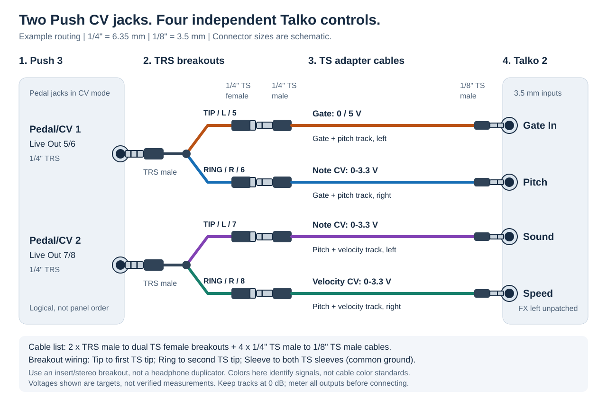
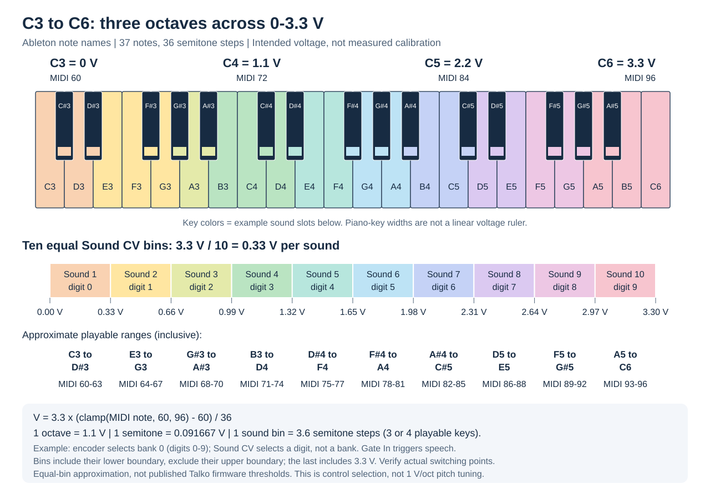
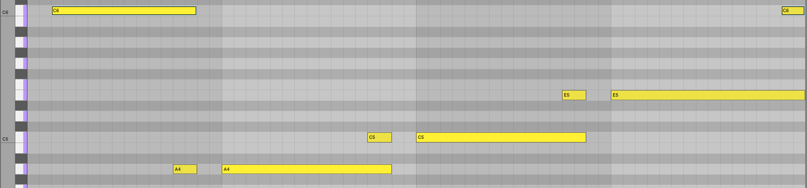

# MI-VO

**MIDI-In, Voltage-Out** is a pair of Ableton Live Max instruments for controlling a Polaxis Talko 2 CV-controlled musical device from an Ableton Push.

The original goal was to use the Push's two stereo CV outputs as four separate CV outputs. This makes it possible to send gate information and three CV signals to the Talko 2. For example, the CV signals can control sound choice, speed, and pitch.

## How it works

MI-VO uses two Max instruments designed to be synchronized in Ableton Live. A single instrument can route only up to two audio signals, so the MIDI information is split across the pair:

- One instrument maps gate and pitch information from a set of MIDI signals to CV.
- The other maps MIDI pitch and velocity values to two additional CV inputs.

Together, the instruments provide the gate and CV signals needed for this control setup. The Talko 2 has more inputs than this setup can control, so not every input is available.

## Important: instrument gain

Keep the track volume fader at **0 dB** (unity) on each instrument track. The devices' voltage scaling assumes 0 dB. Raising the fader above 0 dB raises the output above the intended voltage, and it may clip at the Push's 10 V limit (not tested).

## Devices

Both instruments are self-contained Max for Live devices in [devices/](devices/):

| Device | Outputs | Signals |
|--------|---------|---------|
| `talko_midi_gate_and_pitch.amxd` | Ext. Out 5/6 | Gate (left), pitch (right) |
| `talko_midi_pitch_and_velocity.amxd` | Ext. Out 7/8 | Pitch (left), velocity (right) |

The [src/](src/) folder holds `.maxpat` source versions of both devices, matching the patches embedded in the `.amxd` files.

## Talko 2 voltages

Source: Polaxis, [Talko 2 Eurorack](https://www.polaxis.be/product/talko-2-bricky-eurorack/) and [Talko 2 Bricky](https://www.polaxis.be/product/talko-2-bricky/) product pages. Both list the same CV and gate specifications. The [user manual](https://www.polaxis.be/talko-2-user-manual/) describes the jacks but gives no voltages.

| Input | Recommended | Limits |
|-------|-------------|--------|
| CV (Sound, Speed, Pitch, FX) | 0–3.3 V | Clipped above 3.3 V; tolerates up to +10 V |
| Gate In | 0–5 V | Accepts up to +10 V |

What this means for MI-VO:

- The pitch and velocity CVs top out at 3.3 V, the top of the Talko 2's CV range.
- Gate high is 5 V, the top of the recommended gate range.
- Polaxis says pitch CV "does not follow 1 V/octave". MI-VO's pitch CV is a voltage scale, not a musical scale on the Talko 2.
- By tweaking the instrument logic - this instrument could be extendable to other CV devices.

Not published by Polaxis: the gate high/low threshold, input impedance, and a clock or sync input. The Gate In is the only trigger input.

## Push 3 CV outputs

Sources: Ableton's [CV Tools on Push 3](https://help.ableton.com/hc/en-us/articles/21087935492636-CV-Tools-on-Push-3) and [CV Tools Setup and Routing Pages on Push 3](https://help.ableton.com/hc/en-us/articles/21089380218396-CV-Tools-Setup-and-Routing-Pages-on-Push-3-standalone) articles, and the [Push manual](https://www.ableton.com/en/push/manual/#pedals-cv-tab).

Official specifications:

- Two stereo Pedal/CV jacks. A TRS-to-dual-TS cable splits each jack into two CV outputs, four in total (Tip and Ring for each jack).
- Voltage range is 0–10 V, unipolar only. Resolution is 12 bits and bandwidth is DC–20 kHz.
- Pedal Jack 1 is Live audio channels 5–6, and Pedal Jack 2 is channels 7–8.
- Ableton's CV Instrument calibration sets polarity to Unipolar for these outputs.

What this means for MI-VO:

- The devices send to Ext. Out 5/6 and 7/8, which are the two Pedal/CV jacks.
- All MI-VO outputs are positive, so unipolar mode matches.
- The patches use 0–3.3 V of the 0–10 V range. At 12 bits, one step is about 2.4 mV, or roughly 1/37 of a semitone at 0.0917 V per semitone.
- Ableton does not publish how Live signal level maps to voltage. MI-VO assumes full scale is 10 V.

## Setup

The steps below describe the one layout tested so far: one MIDI track per instrument, controlling a Polaxis Talko 2. Other layouts are untested.

Note that you can use everything here piecemeal - you can trigger just gate and pitch using one instrument, and then use the pots on the Talko for the other two, or any combination that you want.

### Hardware setup

Use the Push 3's **Pedal/CV 1 and 2** jacks, not its main audio outputs. Looking directly at the rear panel, **Pedal 2 is to the left of Pedal 1**. Ableton's official rear-panel image highlights the pair:

[](https://help.ableton.com/hc/en-us/articles/21087935492636-CV-Tools-on-Push-3)

*Rear-panel image: Ableton, [CV Tools on Push 3](https://help.ableton.com/hc/en-us/articles/21087935492636-CV-Tools-on-Push-3), hosted by Ableton rather than copied into this repository.*

The diagram below shows the requested two-stage connection: first split each **1/4" TRS** output into **two 1/4" TS** connections, then run **1/4" TS to 1/8" TS cables** to the Talko 2. It is a signal-flow diagram, not a drawing of the physical panel positions.



Cable list for this version:

- **2 x 1/4" TRS male to dual 1/4" TS female insert/stereo breakouts.** Each TRS plug goes into one Push Pedal/CV jack.
- **4 x 1/4" TS male to 1/8" TS male cables.** Each plugs into one breakout socket and one Talko input. The sizes are also called 6.35 mm and 3.5 mm.
- If your breakouts end in **TS male plugs** instead, use four **1/4" TS female-to-female couplers** before the four adapter cables, or use adapter cables with matching female ends.

Use a true **TRS-to-dual-TS breakout**, not a headphone splitter that duplicates the same stereo signal. Tip becomes one TS signal, Ring becomes the other, and Sleeve connects to both TS sleeves as the common ground. The cables change connectors only; they do **not** scale voltage. Identify Tip and Ring from the cable's labels or continuity, not an assumed color convention.

One possible Talko input assignment, used in the diagram:

| Push jack | TRS contact / Live channel | MI-VO signal | Talko 2 input |
|-----------|----------------------------|--------------|---------------|
| Pedal/CV 1 | Tip / left / Out 5 | Gate, 0 or 5 V target | Gate In |
| Pedal/CV 1 | Ring / right / Out 6 | Note-derived CV, 0–3.3 V target | Pitch |
| Pedal/CV 2 | Tip / left / Out 7 | Note-derived CV, 0–3.3 V target | Sound |
| Pedal/CV 2 | Ring / right / Out 8 | Velocity-derived CV, 0–3.3 V target | Speed |

Here the first track triggers speech and controls its pitch; the second chooses the sound and its speed. "Pitch" in a MI-VO device name means the incoming **MIDI note number**; its CV can drive Sound instead of Pitch. FX remains unpatched. The Talko's encoder chooses the bank, and an unpatched CV input uses its corresponding knob. Its Audio Out goes separately to your mixer/audio interface; it is not one of these four control cables.

Ableton's own CV adapter is an alternative: **1/4" TRS male to dual 1/8" TS female**, followed by ordinary 1/8" TS patch cables. It skips the intermediate 1/4" TS connections shown here.

Configure and measure the outputs in the steps below **before connecting them to the Talko**.

### 1. Enable the Push CV outputs

1. In Live's audio preferences, enable the two stereo outputs for the Push - label them as:
   - Push CV Output 1 - Tip
   - Push CV Output 1 - Ring
   - Push CV Output 2 - Tip
   - Push CV Output 2 - Ring
2. On the Push, open **Setup → Pedals & CV** and set both **Pedal & CV 1** and **Pedal & CV 2** to **CV Out**.
3. The outputs then appear in Live by the aforementioned names, paired as stereo.

### 2. Add two MIDI tracks

1. Create two MIDI tracks.
2. Load `talko_midi_gate_and_pitch.amxd` on the first track and `talko_midi_pitch_and_velocity.amxd` on the second.
3. Set each track's audio output to its Push CV output pair:
   - Gate and pitch track: Push CV Output 1 (left channel = Tip, right channel = Ring)
   - Pitch and velocity track: Push CV Output 2 (left channel = Tip, right channel = Ring)
4. Keep the track volume fader at 0 dB and no effects on either track.

### 3. Understand how the two tracks work together

The two devices split the work. The gate and pitch track sends the gate signal, along with pitch on the right channel. The pitch and velocity track provides two more CV values. Nothing needs to match exactly between the tracks, but both must receive MIDI notes for their CV outputs to update.

### 4. Check voltages before connecting

Measure each output with a multimeter before connecting the Talko 2. The devices' calibration has not yet been verified against the Talko 2. The gate-high voltage of 5 V is within the Talko 2's recommended gate range, but it is still assumed.

The source patches and packaged devices both convert target volts to audio signal with **`volts / 10`**, assuming a 10 V full-scale output and **0 dB** track faders. The earlier `volts / 20` scaling compensated for an accidental **+6 dB** fader setting, which nearly doubled the signal; that compensation is no longer used. The diagrams below describe the **intended mapping**, not verified hardware measurements. Measure C3, C4, C5, C6, and gate high/low before relying on the sound-selection ranges.

### Note-to-voltage mapping

Both note-derived outputs use the same linear mapping. These are **Ableton's octave names**: C3 = MIDI 60 (middle C), C4 = 72, C5 = 84, and C6 = 96. Other software may call MIDI 60 C4; use the MIDI numbers to avoid an octave mismatch.

```text
target volts = 3.3 * (clamp(MIDI note, 60, 96) - 60) / 36
```

That is **1.1 V per octave** and **3.3 / 36 ≈ 0.091667 V per semitone**. Three octaves contain 36 semitone intervals, or 37 playable notes when both endpoints are included. Notes below C3 clamp to 0 V; notes above C6 clamp to 3.3 V. The note-derived outputs hold their last value on note-off.

| Ableton note | MIDI number | Semitones above C3 | Target voltage |
|--------------|-------------|-------------------|----------------|
| C3 | 60 | 0 | 0 V |
| C4 | 72 | 12 | 1.1 V |
| C5 | 84 | 24 | 2.2 V |
| C6 | 96 | 36 | 3.3 V |



#### Example: a Talko bank with ten sounds

The [Talko 2 manual](https://www.polaxis.be/talko-2-user-manual/) lists **bank 0: Numbers (0–9)**, a concrete ten-sound example. Turn the **encoder** to select that bank. The **Sound CV** then selects an item *within* it; Sound CV does not select the bank. The [product specification](https://www.polaxis.be/product/talko-2-bricky-eurorack/) describes Sound CV as linear over its 0–3.3 V range.

For an **equal-bin approximation**, divide the voltage span by the number of sounds:

```text
voltage per sound = 3.3 V / 10 = 0.33 V
semitone steps per sound = 36 / 10 = 3.6
sound slot (1–10) ≈ min(9, floor(target volts / 0.33)) + 1
```

For example, the first tenth is **0 ≤ V < 0.33 V**, corresponding to **60 ≤ MIDI note < 63.6**. Whole MIDI notes 60–63 are **C3–D#3**. D#3 targets 0.275 V; E3 targets about 0.367 V and falls in the next bin.

| Sound slot | Spoken digit in bank 0 | Approximate CV interval | MIDI notes (inclusive) | Ableton notes (inclusive) |
|------------|------------------------|-------------------------|------------------------|---------------------------|
| 1 | 0 | 0.00 ≤ V < 0.33 | 60–63 | C3–D#3 |
| 2 | 1 | 0.33 ≤ V < 0.66 | 64–67 | E3–G3 |
| 3 | 2 | 0.66 ≤ V < 0.99 | 68–70 | G#3–A#3 |
| 4 | 3 | 0.99 ≤ V < 1.32 | 71–74 | B3–D4 |
| 5 | 4 | 1.32 ≤ V < 1.65 | 75–77 | D#4–F4 |
| 6 | 5 | 1.65 ≤ V < 1.98 | 78–81 | F#4–A4 |
| 7 | 6 | 1.98 ≤ V < 2.31 | 82–85 | A#4–C#5 |
| 8 | 7 | 2.31 ≤ V < 2.64 | 86–88 | D5–E5 |
| 9 | 8 | 2.64 ≤ V < 2.97 | 89–92 | F5–G#5 |
| 10 | 9 | 2.97 ≤ V ≤ 3.30 | 93–96 | A5–C6 |

These bins include the lower boundary and exclude the upper boundary, except the final bin includes 3.3 V. Since MIDI notes are discrete, each bin contains three or four playable keys, not exactly 3.6 keys. The colored keyboard shows those memberships; the equally spaced voltage bins below it are the linear ruler, not the physical widths of the piano keys.

**Approximate, not a firmware guarantee:** Polaxis documents linear selection but does not publish the exact quantization/rounding thresholds. Firmware behavior and output calibration can shift the observed note boundaries. Start near the middle of each bin and check which sound plays, rather than assuming a boundary note will always select the same sound. A bank with a different sound count needs a different division: `3.3 V / sound count`.

In the example wiring, play notes on the **pitch and velocity track** to set Sound CV, and use the **gate and pitch track** to trigger the selected sound. To test sound selection independently, hold the desired Sound CV note first, then trigger Gate In. The velocity output follows a separate scale, `3.3 * velocity / 127`, and holds on note-off; the gate is binary, not part of this keyboard mapping.

This mapping is for **voltage control and sound selection**, not calibrated musical pitch: Talko's Pitch input does **not** follow 1 V/octave.

### A Note on Sequencing

There are race conditions between the CV output voltages and the gating trigger - as such, it's sometimes better to "prep" the next CV by putting in a note during the previous execution to draw the voltage correctly ahead of the next gate.  See the example below.

Also note that the speed settings on the Talko and BPM of the sequence often interact and can cut samples too short, etc... if not planned correctly!



## Future

Planned improvements include:

- **Instrument UI:** build a user interface for both instruments so they are easier to use in Ableton Live.
- **General CV control:** generalize beyond the Talko 2 with more flexible signalling and settings.
- **Add usage video and screenshots:** add some useful usage tips and examples.
- **A way to fix race conditions?** it may be possible to delay the trigger until after CV values are sent?